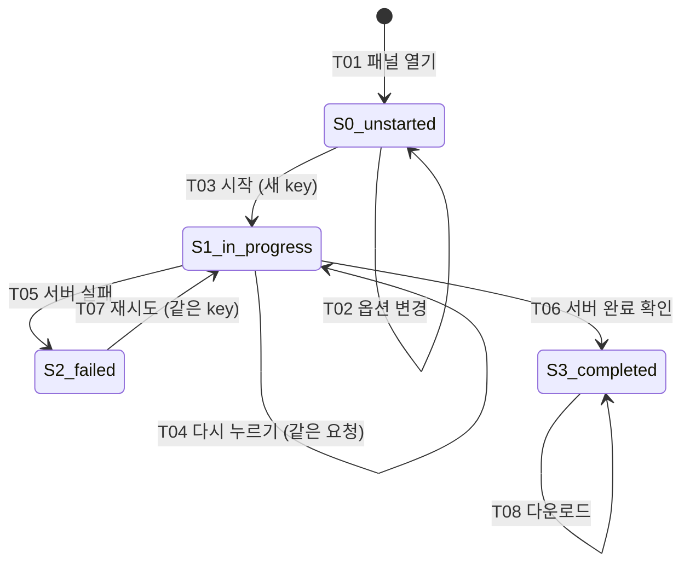

# User flow: 내보내기 패널 (`FLOW-export`)

상태: **다운스트림 초안 작성 가능 (선택 경로 명세 완료) / 사용자 검증 전**

## 출처와 범위

- 출처: 2026-10-17 대화에서 사용자가 전달한 정책 목록. 이 저장소에는 IA 문서, 기존 디자인 산출물, 구현 코드가 없습니다. 그래서 아래 내용은 모두 **제안된 계약**이며, 실제 동작을 관찰한 결과가 아닙니다.
- 포함 범위: 내보내기 패널을 열고, 시작하고, 진행·실패·재시도·완료를 거쳐, 다운로드하고, 닫았다가 다시 여는 흐름.
- 제외 범위: 화면 디자인, 구현, 취소 기능(이번 범위에 없음), 새로고침 이후 복원(정책 미정).

### 표기

- **[정책]**: 사용자가 정한 결정입니다. 변경하지 않습니다.
- **[해석]**: 정책을 이 흐름에 적용하려고 제가 추론한 내용입니다. 확인이 필요합니다.
- **[미정]**: 아직 정하지 않은 정책입니다. 해당 전이는 미해결로 둡니다.

## 과업 사실

| 항목 | 내용 |
|---|---|
| Actor | 로그인한 편집자 [정책] |
| 진입 destination | `exports-panel` [정책] |
| 복귀 부모 destination | `documents-list` [정책] |
| 목표 | 선택한 옵션으로 내보내기를 요청하고 결과물을 받는다 |
| 관찰 가능한 성공 조건 | 서버가 완료를 확인한 뒤 패널에 receipt와 다운로드가 나타난다 [정책] |

## 상태 모델

작업 상태와 패널 표시 여부는 **서로 독립된 두 축**입니다. 패널을 닫아도 작업 상태는 바뀌지 않고 요청도 취소되지 않습니다 [정책].

### 작업 상태 (operation)

| ID | 의미 | options | request key | receipt / 다운로드 |
|---|---|---|---|---|
| `S0-unstarted` | 아직 시작하지 않음 | 있음 (편집 가능) | 없음 | 없음 |
| `S1-in-progress` | 요청이 시작되어 서버 확인을 기다림 | 있음 (시작 시점 값으로 고정) | 있음 | 없음 |
| `S2-failed` | 요청 실패 | 보존 | 보존 (같은 key) | 없음 |
| `S3-completed` | 서버가 완료를 확인함 | 보존 | 보존 | 있음 |

- `S0`에는 request key와 receipt가 없습니다 [정책]. 그래서 `S0`을 닫았다가 다시 열면 복원할 데이터는 options뿐입니다 [해석].
- receipt와 다운로드는 `S3`에서만 존재합니다. 시작했다는 사실만으로는 완료로 보지 않습니다 [정책].
- `S1`에서 options는 시작 시점 값으로 고정됩니다. 같은 key로 처리되는 같은 요청이 같은 입력을 가리키게 하기 위해서입니다 [해석].

### 패널 표시 여부 (visibility)

| ID | 의미 |
|---|---|
| `V-open` | 사용자가 `exports-panel`에 있음 |
| `V-closed` | 사용자가 `documents-list`로 돌아감. 작업은 계속 존재하고 진행될 수 있음 |

## 전이 표 (기준 문서)

이 전이 표가 기준입니다. 이 문서의 다른 부분과 충돌하면 전이 표를 따릅니다.

| ID | 출발 상태 | 사용자 행동 / 시스템 이벤트 | 전제 조건 | 피드백 | 도착 상태 | 데이터 유지 / 변경 | 근거 |
|---|---|---|---|---|---|---|---|
| T01 | `documents-list`, 이번 세션에 작업 없음 | 내보내기 패널 열기 | 로그인한 편집자 | 패널 표시, 옵션 입력 가능 | `S0` + `V-open` | 초기 options만 있음 | 정책 |
| T02 | `S0` + `V-open` | 옵션 변경 | 없음 | 변경된 값 표시 | `S0` | options 갱신 | 정책 |
| T03 | `S0` + `V-open` | 시작 | options가 유효함 (검증 규칙은 미정, O7) | 진행 중임을 표시 | `S1` | **새 request key 생성**, options 고정 | 정책 |
| T04 | `S1` + `V-open` | 시작(또는 재시도) 다시 누르기 | 없음 | 계속 진행 중으로 표시. 새 작업이 생긴 것처럼 보이면 안 됨 | `S1` | key 그대로, 새 요청 없음 (같은 요청으로 처리) | 정책 |
| T05 | `S1` (패널 열림·닫힘 무관) | 서버 실패 응답 | 없음 | 열려 있으면 실패를 알리고 재시도 제공 | `S2` | options와 key 보존 | 정책 |
| T06 | `S1` (패널 열림·닫힘 무관) | 서버 완료 확인 | 없음 | 열려 있으면 완료를 알리고 receipt와 다운로드 표시 | `S3` | receipt 생성, 다운로드 가능 | 정책 |
| T07 | `S2` + `V-open` | 재시도 | 없음 | 진행 중임을 표시 | `S1` | **같은 key**, 보존된 options | 정책 |
| T08 | `S3` + `V-open` | 다운로드 | 서버가 완료를 확인함 | 다운로드 시작 | `S3` | 변경 없음 | 정책 (다운로드 실패·만료는 O5) |
| T09a | `S0` + `V-open` | 패널 닫기 | 없음 | `documents-list`로 이동 | `S0` + `V-closed` | options 유지 | 정책 + 해석 |
| T09b | `S1` + `V-open` | 패널 닫기 | 없음 | `documents-list`로 이동. 요청은 계속 진행됨 | `S1` + `V-closed` | key, options 유지. **요청 취소 안 함** | 정책 |
| T09c | `S2` + `V-open` | 패널 닫기 | 없음 | `documents-list`로 이동 | `S2` + `V-closed` | options, key 유지 | 정책 |
| T09d | `S3` + `V-open` | 패널 닫기 | 없음 | `documents-list`로 이동 | `S3` + `V-closed` | options, key, receipt 유지 | 정책 |
| T10 | `Sx` + `V-closed` (같은 세션) | 패널 다시 열기 | 같은 세션 | 그 시점의 작업 상태를 그대로 표시 | `Sx` + `V-open` (닫혀 있는 동안 T05·T06이 일어났다면 그 결과 상태) | 해당 상태의 데이터 전부 복원 | 정책 |
| T11 | 모든 상태 | 페이지 새로고침 | 없음 | **[미정]** | **[미정]** | **[미정]** | O1 |
| T12 | `S1` | 취소 | 없음 | 제공하지 않음 | 없음 | 없음 | 범위 밖 [정책] |

참고:
- T05와 T06은 `V-closed`에서도 일어납니다. 그래서 닫혀 있는 동안 서버가 완료하면 다시 열었을 때 `S3`가 보입니다 [정책]. 닫혀 있는 동안 실패하면 다시 열었을 때 `S2`가 보입니다 [해석: T05와 복원 정책을 함께 적용한 결과].
- `S0`에서 시작을 두 번 빠르게 누르는 경우: 첫 번째 누름이 T03으로 key를 만들고, 두 번째 누름은 T04로 처리됩니다. key는 하나만 생깁니다 [해석].

## 다이어그램

전이 표와 같은 내용입니다. 패널 닫기(T09)와 다시 열기(T10)는 모든 작업 상태에 적용되며, 작업 상태를 바꾸지 않으므로 다이어그램에서는 생략했습니다.

## 경로 점검

작성자가 내부 일관성만 확인한 결과입니다. 실제 사용자나 구현으로 검증한 것은 아닙니다.

| 경로 | 순서 | 결과 |
|---|---|---|
| P1 정상 완료 | T01 → T02 → T03 → T06 → T08 | 통과. receipt와 다운로드는 T06 이후에만 존재함 |
| P2 중복 시작 | T03 → T04 → T04 → T06 | 통과. key는 하나이고 작업도 하나임 |
| P3 실패 후 재시도 | T03 → T05 → T07 → T06 | 통과. options와 key가 보존되고 재시도에도 같은 key를 씀 |
| P4 시작 전 닫고 다시 열기 | T01 → T02 → T09a → T10 | 통과. options만 복원되고 key와 receipt는 없음 [해석] |
| P5 진행 중 닫기, 닫힌 동안 완료 | T03 → T09b → T06 → T10 | 통과. 다시 열면 `S3`, receipt와 다운로드가 있음 |
| P6 진행 중 닫기, 닫힌 동안 실패 | T03 → T09b → T05 → T10 → T07 | 통과. 다시 열면 `S2`, 같은 key로 재시도함 [해석] |
| P7 실패 상태에서 닫고 다시 열기 | T05 → T09c → T10 → T07 | 통과 |
| P8 완료 후 닫고 다시 열기 | T06 → T09d → T10 → T08 | 통과 |
| P9 새로고침 | T11 | **점검 불가.** 정책 미정 (O1) |

- 고아 상태: 없음. 모든 상태에서 다음 행동 또는 의도된 이탈(T09)로 이어집니다.
- 막다른 상태: `S1`에는 사용자가 결과를 앞당길 행동이 없습니다. 취소는 범위 밖이고, 사용자는 기다리거나 닫을 수 있습니다. 서버가 끝내 응답하지 않는 경우는 O3에서 정해야 합니다.

## 미정 사항

| ID | 질문 | 영향받는 전이 |
|---|---|---|
| O1 | 새로고침 이후에 작업 상태와 데이터를 복원하나요? 복원한다면 무엇을 복원하나요? (특히 `S1`의 key, `S3`의 receipt) | T11 |
| O2 | `S2`에서 옵션을 수정할 수 있나요? 수정할 수 있다면 같은 key 재시도 정책과 충돌합니다. 새 key가 필요한지 정해야 합니다. | T07 (추가 전이 후보) |
| O3 | 서버가 응답하지 않거나 클라이언트에서 시간 초과가 나면 `S1`에 머무나요, 아니면 `S2`로 바꾸나요? | T05 |
| O4 | `S3` 이후 같은 패널에서 새 내보내기를 시작할 수 있나요? 시작할 수 있다면 기존 receipt는 어떻게 되나요? | `S3`에서 나가는 전이 후보 |
| O5 | 다운로드가 실패하거나 다운로드 링크가 만료되면 어떻게 처리하나요? | T08 |
| O6 | "같은 세션"의 범위와 "해당 작업"을 식별하는 기준은 무엇인가요? (문서별, 사용자별 등) 같은 세션에 작업이 여러 개 있으면 어느 작업을 복원하나요? | T01, T10 |
| O7 | 옵션의 유효성 조건과 기본값은 무엇인가요? | T01, T03 |

## 화면이 노출해야 할 정보와 행동 (`exports-panel`)

시각 구성은 정하지 않았습니다. 상태별로 반드시 보여야 할 정보와 제공해야 할 행동만 적었습니다.

| 상태 | 보여야 할 정보 | 제공할 행동 |
|---|---|---|
| `S0` | 현재 options | 옵션 변경(T02), 시작(T03), 닫기(T09a) |
| `S1` | 진행 중이라는 사실, 사용된 options, 닫아도 요청이 계속된다는 사실 | 닫기(T09b). 시작 버튼을 계속 보여준다면 다시 눌러도 같은 요청으로 처리(T04) |
| `S2` | 실패했다는 사실, 보존된 options | 재시도(T07), 닫기(T09c) |
| `S3` | 완료되었다는 사실, receipt | 다운로드(T08), 닫기(T09d) |

`documents-list`에서는 패널 열기(T01/T10)를 제공해야 합니다. 패널이 닫혀 있는 동안 진행 중이거나 완료된 작업을 목록에서 표시할지는 정하지 않았습니다. 이 결정은 wireframe 단계로 넘깁니다.
