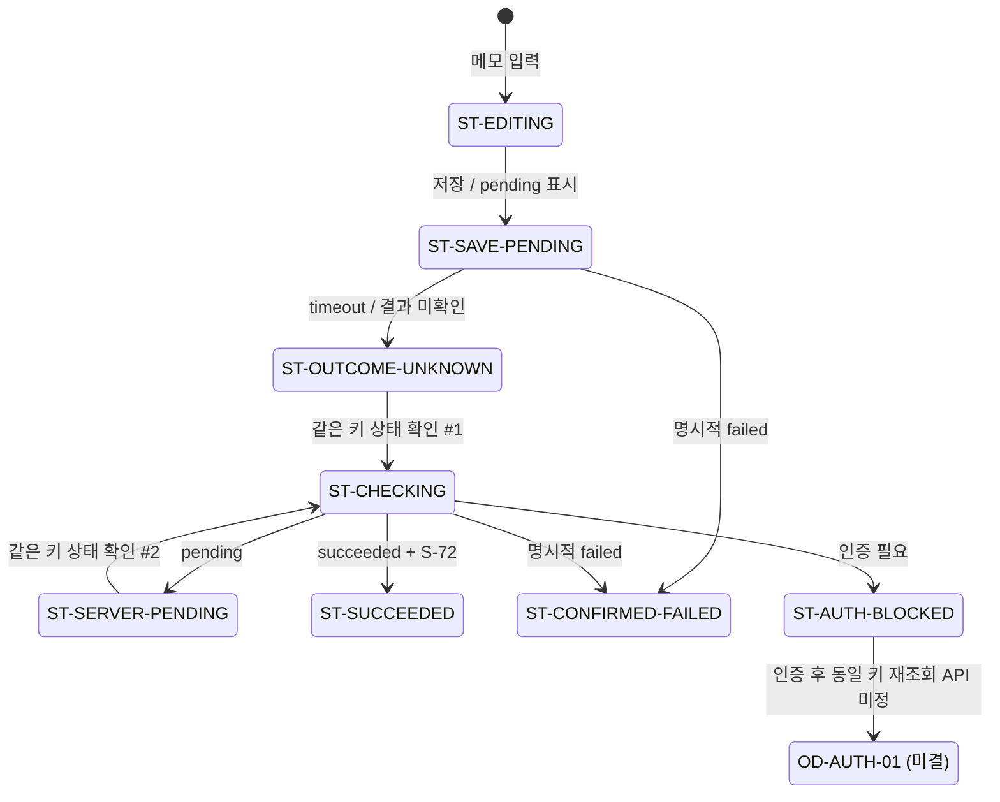

# T-SAVE 사용자 흐름 전이 계약

- 흐름 ID: `UF-TSAVE-72`
- 기준 자료: `BRIEF.md`의 **공유 자료함, 결정본 PB-72 revision 3**
- 작성 기준일: 2026-10-14
- 기존 목적지: `D-ITEM` (`/items/:id`), `D-SAVED` (`/saved`), `D-LIB` (`/library`)
- 대상 자료: `R-72` — **작은 팀에서 실패 후 다시 시도하기**
- 상태: 하위 설계가 참조할 수 있는 전이 계약. 사용자 수용 또는 구현 검증 완료를 뜻하지 않는다.

## 1. 작업 경계와 성공 조건

**행위자**는 팀의 읽기 목록에서 `R-72` 상세에 들어온 사용자다. **시작점**은 `D-ITEM`에서 저장 패널을 열어 메모 초안을 입력할 수 있는 상태다. **의도한 결과**는 메모와 `R-72`의 저장이 서버에서 확인되는 것이다.

성공은 다음 두 조건이 함께 화면에 드러날 때만 성립한다.

1. 서버 상태가 `succeeded`로 확인된다.
2. 그 작업의 유일한 receipt `S-72`가 표시된다.

`timeout` 자체, 로컬 낙관적 표시, 요청 전송 완료, 첫 번째 상태 확인의 `pending`은 성공이 아니다. 서버의 명시적 `failed` 응답만 실제 실패이며, timeout으로 처리 여부를 모르는 상태와 구분한다.

범위는 T-SAVE의 입력, 저장 시작, 상태 확인, 중복 입력, 닫기·재진입, 성공·실패·인증 의존성까지다. 화면 배치, 새 목적지, 전체 사이트맵, 서버 API 설계, 초대 만료 권한 정책, 실제 구현은 범위 밖이다.

## 2. 결정된 정책, 제안, 미결 사항

### 공급 자료에서 결정된 정책

- 저장 요청 직후에는 `pending`을 표시한다.
- 첫 저장 요청은 `timeout-unknown`이다. 성공이나 실패로 단정하지 않는다.
- 이 상태의 승인된 복구는 **동일 작업의 상태 확인**이며 새 저장 요청 재전송이 아니다.
- 상태 확인의 첫 결과는 `pending`, 두 번째 결과는 `succeeded`이고 유일한 receipt는 `S-72`다.
- 저장이 해결되지 않은 동안 같은 요청에 대한 중복 입력은 무시한다.
- 닫기는 서버 작업을 취소하지 않으며 메모 초안은 유지한다.
- 인증 복구 뒤 동일 키로 작업을 다시 조회하는 서버 API는 미정이다.
- 상세에서 목록으로 돌아갈 때 기존 문맥 `q='작은 팀'`, `tag='운영'`, `sort='newest'`, 목록 위치 `R-72`는 유지한다.

### 흐름 표현을 위한 설계 제안

- 처리 결과를 모르는 상태에서는 `상태 확인`을 다음 행동으로 노출한다. 이는 승인된 복구 수단을 사용자가 실행할 수 있게 하는 제안이며 화면 배치를 정하지 않는다.
- 같은 작업이 진행 중일 때 반복된 저장 입력에는 기존 진행 상태를 그대로 보여 주고 새 저장 호출을 만들지 않는다.
- 실제 실패 후 초안은 남겨 사용자가 내용을 잃지 않게 한다. 단, 재시도 요청의 키 정책은 서버 결정 전까지 확정하지 않는다.

### 미결 사항

| ID | 미결 결정 | 이 계약에서의 처리 |
| --- | --- | --- |
| `OD-AUTH-01` | 인증 복구 후 기존 저장 키로 상태를 재조회할 서버 API, 응답 및 오류 규약 | `ST-AUTH-BLOCKED`에서 중단한다. 새 저장으로 대체하지 않는다. |
| `OD-RETRY-01` | 서버가 확인한 실제 실패 뒤 재시도가 새 작업·새 키인지, 기존 키 재사용인지 | 실패 상태와 초안 유지까지만 확정하고 재시도 전이는 열어 둔다. |
| `OD-PERSIST-01` | 초안·저장 키가 새로고침, 탭 종료 또는 다른 기기까지 얼마나 오래 유지되는지 | 같은 상세의 닫기·재진입에서만 유지된다고 명세한다. 그보다 긴 지속성은 주장하지 않는다. |
| `OD-ACCESS-01` | 초대가 만료된 팀 자료를 계속 읽을 수 있는지 | T-SAVE 밖의 권한 정책으로 남긴다. |

## 3. 상태 모델

`saveKey`는 같은 저장 작업을 식별하는 값의 논리적 이름이다. 실제 형식과 생성 주체는 정하지 않는다. `receipt`는 성공 전까지 비어 있고 성공 시에만 `S-72`다.

| 상태 ID | 목적지 | 사용자가 인지해야 하는 상태 | 보존 데이터 | 가능한 다음 행동·사건 |
| --- | --- | --- | --- | --- |
| `ST-READY` | `D-ITEM` | 저장을 시작할 수 있음 | `itemId=R-72`, 기존 목록 문맥 | 초안 입력, 닫기 |
| `ST-EDITING` | `D-ITEM` | 저장되지 않은 메모 초안이 있음 | `R-72`, `draft` | 저장 시작, 초안 수정, 닫기 |
| `ST-SAVE-PENDING` | `D-ITEM` | 저장 요청이 처리 중임 | `R-72`, `draft`, `saveKey`; `receipt=∅` | timeout, 명시적 실패, 중복 입력, 닫기 |
| `ST-OUTCOME-UNKNOWN` | `D-ITEM` | timeout 때문에 서버 처리 결과를 모름; 실패·성공 아님 | `R-72`, `draft`, 동일 `saveKey`; `receipt=∅` | 상태 확인, 중복 입력, 닫기 |
| `ST-CHECKING` | `D-ITEM` | 기존 `saveKey`의 상태를 조회 중임 | `R-72`, `draft`, 동일 `saveKey`, 확인 횟수 | `pending`, `succeeded`, `failed`, 인증 필요, 닫기 |
| `ST-SERVER-PENDING` | `D-ITEM` | 서버가 아직 처리 중이라고 확인함 | `R-72`, `draft`, 동일 `saveKey`, `checkCount=1`; `receipt=∅` | 두 번째 상태 확인, 중복 입력, 닫기 |
| `ST-SUCCEEDED` | `D-ITEM` | 서버 확인으로 저장 완료, receipt `S-72` | `R-72`, 저장된 메모, 동일 `saveKey`, `receipt=S-72` | 닫기, 기존 `D-SAVED`로 이동 가능 |
| `ST-CONFIRMED-FAILED` | `D-ITEM` | 서버가 실제 실패를 명시적으로 확인함 | `R-72`, `draft`, 실패한 `saveKey`; `receipt=∅` | 초안 수정, 닫기; 재시도는 `OD-RETRY-01` 의존 |
| `ST-CLOSED` | `D-ITEM` | 저장 패널은 닫혔지만 상세는 유지됨 | `R-72`, `draft`, 마지막 알려진 작업 상태, 활성 작업이면 동일 `saveKey` | 저장 패널 재진입, 상세에서 나가기 |
| `ST-AUTH-BLOCKED` | 인증 복구 경계 | 상태 확인이 인증 필요로 중단됨 | `R-72`, `draft`, 동일 `saveKey`, 마지막 알려진 상태; `receipt=∅` | 인증 복구, 닫기; 이후 재조회는 `OD-AUTH-01` 의존 |

## 4. 전이 표 — 권위 있는 계약

| 전이 ID | 출발 상태 | 사용자 행동 / 시스템 사건 | 사전조건 | 즉시 피드백 | 도착 상태 | 데이터 변화·보존 | 근거 / 지위 |
| --- | --- | --- | --- | --- | --- | --- | --- |
| `TR-01` | `ST-READY` | 메모 입력 또는 기존 초안 수정 | `R-72` 상세에 접근 가능 | 입력한 초안이 보임 | `ST-EDITING` | `draft` 갱신; 목록 문맥 유지 | 공급 정책 |
| `TR-02` | `ST-EDITING` | 저장 실행 | 저장 요청이 아직 없음 | `pending` 표시 | `ST-SAVE-PENDING` | 한 저장 작업과 `saveKey`를 결합; `draft` 유지; `receipt=∅` | 공급 정책. 키의 구현 형식은 미정 |
| `TR-03` | `ST-SAVE-PENDING` | 첫 요청이 timeout | 서버 처리 여부를 확인하지 못함 | “결과를 확인할 수 없음”과 `상태 확인` 행동; 실패 문구·성공 문구 없음 | `ST-OUTCOME-UNKNOWN` | 동일 `saveKey`와 `draft` 유지; `receipt=∅` | 공급 정책 |
| `TR-04` | `ST-OUTCOME-UNKNOWN` | 상태 확인 실행 | 기존 `saveKey`가 있음 | 기존 작업의 상태를 확인 중임을 표시 | `ST-CHECKING` | 새 저장 요청 없음; 동일 `saveKey`; `checkCount=1` | 공급 정책 |
| `TR-05` | `ST-CHECKING` | 첫 상태 확인 결과 `pending` | `checkCount=1` | 서버가 아직 처리 중임을 표시; 성공·실패 문구 없음 | `ST-SERVER-PENDING` | 동일 `saveKey`, `draft`; `receipt=∅` | 공급 정책 |
| `TR-06` | `ST-SERVER-PENDING` | 상태 확인 다시 실행 | 첫 확인이 `pending`이었음 | 기존 작업을 다시 확인 중임을 표시 | `ST-CHECKING` | 새 저장 요청 없음; 동일 `saveKey`; `checkCount=2` | 공급 정책 |
| `TR-07` | `ST-CHECKING` | 두 번째 상태 확인 결과 `succeeded`와 `S-72` 수신 | `checkCount=2` | 저장 완료와 receipt `S-72`를 명확히 표시 | `ST-SUCCEEDED` | 저장 확정; `receipt=S-72`; 초안은 저장된 메모가 됨 | 공급 정책 |
| `TR-08` | `ST-SAVE-PENDING`, `ST-OUTCOME-UNKNOWN`, `ST-CHECKING`, `ST-SERVER-PENDING` | 사용자가 같은 저장을 반복 입력 | 같은 `saveKey`의 작업이 해결되지 않음 | 현재 진행·미확인 상태를 유지 | 같은 출발 상태 | 입력 무시; 새 저장 요청·새 receipt·새 작업 생성 없음 | 공급 정책 |
| `TR-09` | `ST-SAVE-PENDING` 또는 `ST-CHECKING` | 서버가 해당 작업을 `failed`로 명시 | timeout이나 인증 문제가 아닌 확인된 실패 응답 | 실제 실패임을 표시하고 성공 receipt는 표시하지 않음 | `ST-CONFIRMED-FAILED` | `draft`와 실패한 `saveKey` 유지; `receipt=∅` | timeout-unknown과 구분하기 위한 공급 요구. 고정 성공 경로에서는 미실행 |
| `TR-10` | `ST-EDITING`, `ST-SAVE-PENDING`, `ST-OUTCOME-UNKNOWN`, `ST-CHECKING`, `ST-SERVER-PENDING`, `ST-CONFIRMED-FAILED`, `ST-AUTH-BLOCKED` | 저장 패널 닫기 | 해당 상태에 있음 | `D-ITEM` 본문으로 복귀 | `ST-CLOSED` | `draft` 유지. 활성 서버 작업은 취소하지 않음. 마지막 알려진 상태와 동일 `saveKey` 유지 | 공급 정책 |
| `TR-11` | `ST-CLOSED` | 저장 패널 재진입 | 같은 `R-72` 상세에 머무르고 닫을 때의 `lastState`가 보존됨 | 보존된 초안과 마지막 알려진 작업 상태를 다시 노출 | 보존된 `lastState`: `ST-EDITING`, `ST-SAVE-PENDING`, `ST-OUTCOME-UNKNOWN`, `ST-CHECKING`, `ST-SERVER-PENDING`, `ST-CONFIRMED-FAILED` 또는 `ST-AUTH-BLOCKED` | 자동 저장·재전송 없음. `draft`와 동일 `saveKey` 유지 | 공급 정책의 닫기·초안 유지에서 도출한 흐름 제안; 장기 지속성 제외 |
| `TR-12` | `ST-CHECKING` | 상태 확인이 인증 필요로 중단 | 동일 `saveKey` 재조회 중 | 인증이 필요하고 저장 결과는 아직 모른다고 표시 | `ST-AUTH-BLOCKED` | `draft`, 동일 `saveKey`, 마지막 알려진 상태 유지; `receipt=∅` | 공급 정책 |
| `TR-13` | `ST-AUTH-BLOCKED` | 사용자가 인증 복구 완료 | 인증 성공은 알지만 기존 작업 결과는 모름 | 새 저장을 만들지 않고 동일 키 상태 재조회가 필요함을 알림 | **미결 — `OD-AUTH-01`** | 동일 `saveKey`를 버리거나 교체하지 않음 | 서버 API 미정; 전이 확정 금지 |
| `TR-14` | `ST-CONFIRMED-FAILED` | 사용자가 재시도 선택 | 서버가 실제 실패를 확인함 | 새 시도 규칙이 필요함 | **미결 — `OD-RETRY-01`** | 기존 `draft` 유지; 기존 실패를 성공으로 덮지 않음 | 서버 키 정책 미정; 전이 확정 금지 |
| `TR-15` | `ST-CLOSED` | 상세에서 뒤로 이동 | 기존 목록 진입 문맥이 있음 | 이전 목록 위치로 복귀 | `D-LIB`의 기존 목록 상태 | `q='작은 팀'`, `tag='운영'`, `sort='newest'`, 위치 `R-72` 유지 | 기존 동작 보존. T-SAVE 밖으로 나가는 의도적 종료 |

## 5. 주요 경로

중복 저장 입력은 `ST-SAVE-PENDING`, `ST-OUTCOME-UNKNOWN`, `ST-CHECKING`, `ST-SERVER-PENDING` 각각에서 자기 상태로 돌아오는 전이 `TR-08`이다. 닫기 `TR-10`은 서버 작업을 멈추지 않으며, 재진입 `TR-11`은 새 저장을 만들지 않는다.

## 6. 경로 워크스루 결과

| 경로 | 전이 순서 | 결과 | 검토 결과 |
| --- | --- | --- | --- |
| 고정 성공 경로 | `TR-01 → TR-02 → TR-03 → TR-04 → TR-05 → TR-06 → TR-07` | 두 번째 상태 확인 뒤에만 `S-72`와 성공이 보임 | 내부 모순 없음. timeout과 첫 `pending`에서 성공을 조기에 주장하지 않음 |
| timeout 뒤 중복 저장 | `TR-03 → TR-08 → TR-04` | 새 저장 없이 기존 키를 조회 | 중복 receipt와 이중 작업을 만들지 않음 |
| 첫 확인 pending 뒤 닫기·재진입 | `TR-05 → TR-10 → TR-11 → TR-06 → TR-07` | 초안·같은 작업을 유지하고 두 번째 확인으로 성공 | 닫기가 취소 또는 재전송으로 해석되지 않음. 브라우저 새로고침 이후 지속성은 미검증·미정 |
| 실제 실패 | `TR-02 → TR-09` 또는 `TR-04/06 → TR-09` | `receipt=∅`인 확인된 실패, 초안 유지 | timeout-unknown과 별도 상태. 재시도는 `OD-RETRY-01` 때문에 중단 |
| 인증 복구 | `TR-04/06 → TR-12 → TR-13` | 동일 키를 보존한 채 서버 API 의존성에서 중단 | 새 저장 요청으로 우회하지 않음. `OD-AUTH-01` 해결 전 완결 불가 |
| 의도적 이탈 | `TR-10 → TR-15` | 기존 목록 문맥으로 돌아감 | 검색어·태그·정렬·목록 위치를 버리지 않음 |

이 워크스루는 문서의 전이 일관성을 검토한 것이며 실제 사용자 성공이나 구현 동작을 입증하지 않는다. 브라우저 런타임 관찰은 로컬 실행 제약으로 수행하지 못했으며 자세한 내용은 `output/report.md`에 기록했다.

## 7. 하위 설계가 노출해야 할 정보와 행동

화면 구성은 정하지 않되, `D-ITEM`의 T-SAVE 표면은 현재 상태에 따라 다음 정보를 접근 가능하게 해야 한다.

- 항상: 대상 자료 `R-72`, 메모 초안, 저장 또는 현재 작업 상태, 닫기.
- `ST-OUTCOME-UNKNOWN`: 성공·실패가 아니라 결과 미확인임을 알리는 문구, 기존 작업의 `상태 확인`.
- `ST-SERVER-PENDING`: 서버가 처리 중임을 알리는 문구, 같은 작업의 두 번째 `상태 확인`.
- `ST-SUCCEEDED`: 서버 확인 완료와 유일한 receipt `S-72`; `D-SAVED`는 기존 목적지로만 사용하고 자동 이동 여부는 이 계약에서 결정하지 않음.
- `ST-CONFIRMED-FAILED`: 확인된 실패, 보존된 초안; 재시도는 `OD-RETRY-01` 결정 전 확정하지 않음.
- `ST-AUTH-BLOCKED`: 인증 필요, 아직 결과 미확인, 동일 작업을 유지해야 한다는 점; 인증 뒤 전이는 `OD-AUTH-01` 결정 전 확정하지 않음.

본문의 `출처로 이동`과 `본문으로 건너뛰기`는 현재 자료, 초안 또는 T-SAVE 상태를 바꾸지 않는 기존 불변 조건으로 유지한다.
