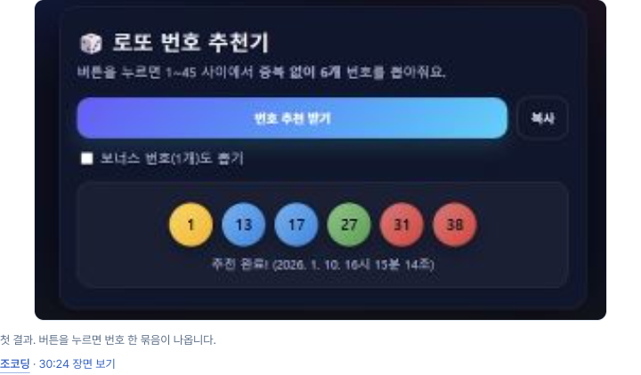
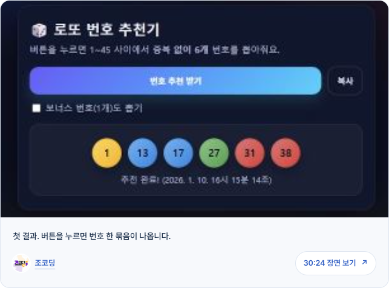

# INFLFEED 아티클 세션 재분석

2026-10-14 KST. 대상 채팅: **기획하기: 유입 콘텐츠와 SNS 홍보**, `01a10c76-c117-7112-a572-37b1668ad219`. 대상은 `/ko/articles/ai-maker-first-five` 전체 페이지다.

**후속 QA 보완 완료:** 개수·넘침 assertion과 키보드 범위를 보완해 새 브라우저 실행으로 배치 24건, 자연스러운 키보드 경로 24건, 결함 주입 거부 18건을 확인했다. [변경 내용과 재검증 보고서](QA-REPAIR.md). 아래 5단계 기록은 당시 실행 범위를 보존한다.

**완료된 로컬 작업은 증거가 있는 범위에서 통과했다.** 첫 접근성 수정 이후, 데이터 연결·빌드 문제 해결, 본문 통합, 가독성 개선, 캡처 컴포넌트 개선까지 확인했다. 이전 보고서의 빌드 실패와 5명 온보딩 미완료를 최종 상태로 유지하면 부정확하다. 반대로 첫 수정의 ‘화면 차이 0’을 이후 디자인 변경까지 확대해도 부정확하다.

이 기록은 한 세션의 실전 적용 사례다. 원본 스킬과 동일 과제를 비교한 실험이 아니므로 **17개 스킬의 원본 이상 판정이나 승격 근거로 단독 사용하지 않는다**. 기존 [17역할 비교 평가](../design-role-parity-2026-10-12/RESULTS.md)의 실험 수와 판정은 변경하지 않았다.

## 조사 범위와 방법

- 관련 최근 8개 턴에서 사용자 요청과 최종 답변을 읽고, 완료된 5단계의 보고서·패치·검증 코드·원시 로그·이미지를 대조했다. 앞선 콘텐츠 제작은 입력 이력이며 별도 독립 평가로 세지 않았다.
- 임시 디렉터리 정리에 대비해 원시 산출물과 소스 **465개, 126,237,068바이트**를 로컬에 복사했다. 복사 중 원본 변동은 없었고, 보존본 SHA-256 재검사 불일치는 0개다. 실행 당시 읽은 고정 번들 파일 **23개**도 별도로 보존하고 기록된 해시와 일치함을 확인했다.
- 로그의 성공 문구를 옮기는 데 그치지 않고, 접근성 이름 결과, PNG 픽셀, 캡처 위치, 프로필·선택 상태, 읽기 구조를 재계산했다. 최초 재분석은 **저장된 증거의 오프라인 재검산**이었다. 이후 별도 요청에 따른 새 브라우저 실행은 QA-REPAIR.md에 구분해 기록했다.
- 핵심 이미지 5개와 측정 JSON 3개는 이 평가 폴더에 복사했다. 전체 원시 묶음은 `.scratch/design-field-review-20261014/`에만 있으며 Git으로 배포되는 평가 자료에 포함되지 않는다.
- 원시 증거와 주장별 연결은 [EVIDENCE.md](EVIDENCE.md), 구조화된 결과는 [results.json](results.json), 선정 자료의 해시는 [evidence-manifest.json](evidence-manifest.json)에 있다.

## 단계별 결과

| 단계 | 사용자 요청과 변경 | 검증된 결과 | 판정의 경계 |
| --- | --- | --- | --- |
| 1. 접근성 이름 | 원본 디자인을 유지하고 실제 문제 하나 수정. 표시 행동명과 `aria-label`을 `actionLabel` 하나로 통일 | 5카드 × 3폭의 불일치 15건 → 0건. 새 탭 안내 유지. 전체·카드 PNG 6쌍 모두 0픽셀 차이 | 제품 수정 1파일 +3/-2줄. 이 단계의 전체 빌드와 상세·온보딩은 당시 미완료 |
| 2. 환경·이미지 복구 | 별도 작업 환경의 공개 카탈로그 연결과 프로필 이미지 허용 경로 수정 | 상세 5명 × 3폭, 사진 로드, 5→4명 해제→새로고침 4명 유지→5명 복원→가입 전 요약 5명. 전체 빌드 521/521, 기존 단위 테스트 18개 통과 기록 | 공유 로컬 DB를 동기화하거나 마이그레이션한 것이 아니다. OAuth·계정 생성·구독 저장 제외 |
| 3. 본문 통합 | 별도 개선안의 Markdown·캡처·직접 인용과 기존 콘텐츠/크리에이터 카드를 함께 유지 | 캡처 8, 인용 5, 카드 5쌍. 깨진 M05 이미지는 이전의 같은 원본 파일로 복원. 세 폭 읽기·이동·온보딩 및 전체 빌드 통과 기록 | 사용자 요청으로 본문이 달라진 단계. 공개 원본과 픽셀 동일성을 요구한 실험이 아님 |
| 4. 가독성 | 핵심 메시지, 소제목·목록, 이름 링크, 실제 저자 아바타와 인용 말풍선 | 핵심 문장 6, H3 5, 목록 5. 세 폭에서 링크 밖 크리에이터 이름 0, 인용 5·캡처 8 유지. 이름으로 시작하는 본문이 사라지는 렌더링 조건도 수정 | 발언 원문과 편집 설명 분리. 사용자 이해도나 읽기 속도의 개선은 측정하지 않음 |
| 5. 캡처 컴포넌트 | 이미지와 캡션·저자·원문 링크를 하나의 공통 폭 컴포넌트로 결합 | 데스크톱 첫 이미지/캡션 왼쪽 어긋남 38.953125px → 0. 8캡처 × 3폭의 정렬·링크 영역·이미지 로드 24건 통과. 가로 넘침 없음 | 새로운 컴포넌트의 키보드 테스트는 320px에서 수행. 전체 5명 온보딩은 이 마지막 단계에서 다시 실행하지 않음 |

폭은 1440/390/320 CSS px, 높이는 1000px이다. 좁은 데스크톱 Chrome viewport이며 실기기 터치 검증으로 계산하지 않는다. 원 세션은 Playwright CLI 0.1.22와 전용 브라우저 세션을 사용했다.

## 이번에 바로잡은 해석

**빌드·상세·온보딩의 초기 제한은 후속 단계에서 해결됐다.** 2~5단계에 각각 521/521 빌드 완료 기록이 있다. 상세·온보딩은 2단계 개발/빌드 서버, 3단계 빌드 서버, 4단계 개발 서버의 로그 네 묶음을 재검산했다. 반복 관찰을 서로 다른 사용자나 독립 스킬 실험으로 세지 않는다.

**DB 상태와 환경 연결을 구별해야 한다.** 복구는 시험용 worktree의 연결을 공개 카탈로그로 바꾼 결과다. 공유 로컬 DB의 누락 열이나 데이터가 수정됐다는 증거는 아니다. 로그에 `production`이라고 적힌 테스트도 로컬 빌드 서버 8883/8885를 뜻하며 운영 배포가 아니다.

**원본 유지의 범위가 달라졌다.** 첫 수정의 6쌍은 이번에 PNG를 다시 읽어 RGB 픽셀 동일성을 확인했다. 이후 본문·인용·캡처 변경은 사용자 요청에 따른 시각 변경이다. 4단계 기존 카드 비교는 15개 모두 픽셀 동일하지 않으며, 10개는 캡처 높이가 1px 다르다. 데이터·렌더러 보존과 픽셀 보존을 같은 주장으로 합치지 않는다. [카드 측정](evidence/card-visual-comparison.json).

**사용자가 최종 개선안의 커밋·병합·운영 배포를 요청했다.** 이는 해당 아티클 개선안을 채택하는 의사 표현으로 볼 수 있다. 읽기 성과의 정량 검증, 17개 스킬 전체의 수용, 글로벌 설치나 승격 승인을 뜻하지는 않는다. 실제 릴리스 진행 상태는 아래 별도 기록을 따른다.

## 스킬별 관측 범위와 원본

9개 스킬을 고정 로컬 번들에서 직접 읽어 적용했다. 호스트의 자동 스킬 발견이나 글로벌 플러그인 설치 성공을 시험한 것은 아니다. 아래 8개 adapted 스킬의 직접 원본은 모두 `jakubkrehel/skills`의 동명 경로이며 고정 revision은 `d574cc8a576dc24256ad38268b8d03d86724a1b3`이다. Paul의 추가 지침이 있어 원본과 완전히 같은 파일은 아니다. [출처 스냅샷](skill-source-snapshot.json).

| 스킬 | 직접 원본 또는 성격 | 이번 세션에서 보인 역할 | 이번 세션으로 판정할 수 없는 것 |
| --- | --- | --- | --- |
| design-browser | Paul original. Microsoft Playwright CLI 문서 참고 | 전용 CLI 세션, 전체 스크롤, 같은 조건 캡처, 실제 링크 조작, 로그 보존 | Aside보다 효율적인지, 다른 브라우저·기기에서도 같은지 |
| better-interface | Jakub `skills/better-interface` adapted | 6영역 진단을 묶어 최초 문제 선정, 후속 변경 평가 | 발견해야 할 모든 문제가 잡혔는지, 원본보다 우수한지 |
| better-accessibility | Jakub `skills/better-accessibility` adapted | 보이는 이름과 접근성 이름 통일, 키보드·포커스·reduced-motion 확인 | 실제 스크린리더·음성 제어, 전체 접근성 적합성 |
| better-layout | Jakub `skills/better-layout` adapted | 세 폭 배치, 캡처/캡션 공통 경계, 좁은 폭 줄바꿈 | 모든 반응형 폭이나 긴 콘텐츠 상태 |
| better-writing | Jakub `skills/better-writing` adapted | 핵심 메시지, 행동 이름, 직접 발언과 편집 설명 구별 | 이해도·전환율 향상, 인용 원문 취재의 재검증 |
| better-typography | Jakub `skills/better-typography` adapted | 한글 본문 위계·소제목·목록·강조, 기존 카드 상속값 분리 | 200% 확대, 글꼴 로딩 실패, 실제 읽기 속도 |
| better-colors | Jakub `skills/better-colors` adapted | 브랜드 토큰 유지와 관측한 불투명 텍스트 색상 쌍 대비 측정 | 모든 이미지·그라데이션 배경, 포커스 테두리, forced-colors |
| better-ui | Jakub `skills/better-ui` adapted | 이미지·아바타·캡션을 결합, 기존 CTA 모션 보존 | 실제 터치 hover, 새로운 복잡한 애니메이션 설계 |
| interface-review | Jakub `skills/interface-review` adapted | 요청 직전 저장본을 기준으로 변경 범위·소비자·회귀 검토 | 독립 검토자의 승인. 해당 리뷰는 구현 세션의 자체 검토 |

`information-architecture`, `user-flow`, `wireframe`, `variant`, `build-design`, `state-machine`, `break`, `explain-interface` 8개는 이번 고정 번들의 실전 검증 대상이 아니다. 제품에서 온보딩 흐름을 확인했다는 사실을 `user-flow` 스킬 자체의 실행 증거로 바꾸지 않는다.

후속 작업은 같은 대화 문맥과 이미 읽은 지침을 재사용했다. 따라서 ‘9스킬 × 5단계 = 45회 독립 통과’와 같은 집계는 하지 않는다. 모델·reasoning 설정, 토큰, 실제 비용의 확정 자료는 없어 `null`로 남겼다.

## QA 코드와 평가의 남은 문제

| 중요도 | 발견 | 이번 처리와 후속 작업 |
| --- | --- | --- |
| 해결 | 마지막 캡처 검사 코드가 개수 8개/폭과 가로 넘침을 출력하지만 실패 assertion으로 고정하지 않음 | 새 회귀 코드에서 실패 조건으로 고정. 정상 24건과 결함 주입 거부 기록은 QA-REPAIR.md 참조 |
| 해결 | 캡처 키보드 검사가 viewport 반복 뒤에 있어 320px에서만 실행되고 최초 포커스는 `.focus()`로 설정 | 세 폭의 각 8개 캡처를 새 문서에서 native Tab으로 진입하고 순서·포커스·양쪽 목적지를 검증. 24경로 통과 |
| 중간 | 구현자와 인터페이스 검토자가 같은 세션이며 원본/no-skill 대조군이 없음 | 자체 검토 통과로 기록. 원본 이상 판단에는 별도 세션·동일 조건의 원본/Paul 비교 필요 |
| 낮음 | 초기 테스트의 hydration 대기, native skip-link 판정, 강조 문단 selector 등 테스트 자체의 오류를 수정한 이력 | 최초 실패와 수정 근거를 원시 묶음에 보존. 테스트 수정과 제품 수정을 구별하며 최종 성공만 선별하지 않음 |

이번 재검산 스크립트도 혼합 로그의 viewport 외 JSON 객체와 추가 원본 경로 표를 처음에 함께 읽었다. viewport 객체와 고정 번들 경로를 명시적으로 구분하도록 파서를 고쳤고, 제품 결과의 기대값이나 성공 조건을 완화하지 않았다.

실제 OAuth·계정 생성·구독 저장, Safari/Firefox, 실기기 터치, 실제 스크린리더·음성 제어, 브라우저 200% 확대, 외부 동영상 재생, 성능 지표, 사용자 이해도는 이번 증거로 통과 판정할 수 없다.

## 확인할 화면

캡처 컴포넌트의 변경 전과 후다. 동일 세션의 같은 콘텐츠를 비교한다.





[390px 캡처](evidence/capture-after-390.png), [320px 긴 이름](evidence/capture-long-name-320.png), [390px 직접 인용](evidence/quote-390.png)도 보존했다. 스크린샷만으로 키보드·행동·데이터 보존을 판정하지 않고 각 로그를 함께 사용했다.

## 릴리스와 다음 검증

보고서 작성 중 별도 사용자 요청으로 같은 채팅에서 커밋·PR·병합·배포 작업이 이어졌다. PR #271의 CI 성공과 메인 병합은 GitHub에서 직접 확인했다. 아티클 TSX·CSS는 저장한 소스와 PR head가 동일하며, 검사 스크립트 2개는 운영 익명 검사를 명시적으로 허용하는 조건이 추가됐다. 완료된 5단계의 로컬 증거와 현재 릴리스를 분리했다. 최신 확인 시점·실행 상태·확인 가능한 SHA/URL은 [RELEASE-STATUS.md](RELEASE-STATUS.md)에 기록한다. 이전 단계 보고서의 ‘배포하지 않았다’는 문장은 그 단계 완료 당시의 사실이다.

당시 세션 스냅샷은 운영 배포 완료와 병합 SHA 일치를 보고했으며, 운영 아티클의 이미지·링크·선택 흐름을 최종 확인 중이었다. QA assertion과 키보드 범위는 후속 작업으로 보완했고 그 전달 상태는 QA-REPAIR.md에 있다. 원본/Paul의 추가 동등성 판정에는 같은 과제·모델·도구 조건의 별도 세션 비교가 필요하다.

## 재검산

현재 로컬 보존 묶음과 Pillow가 설치된 Python을 사용한다. 브라우저나 제품 소스에 쓰지 않고 저장된 증거만 읽으며, 파생 결과 JSON을 보존 폴더에 갱신한다.

```sh
/Users/jinhokim/.cache/codex-runtimes/codex-primary-runtime/dependencies/python/bin/python3 evals/design-field-trial-2026-10-14/recheck_evidence.py
```

이 평가 폴더만 복제한 환경에는 원시 묶음이 없다. 이 경우 선정 이미지·측정치와 해시는 확인할 수 있지만 465개 전체 자료 재검산은 할 수 없다. 원시 자료를 외부에 게시하기 전에는 별도로 공개 범위를 검토해야 한다.
